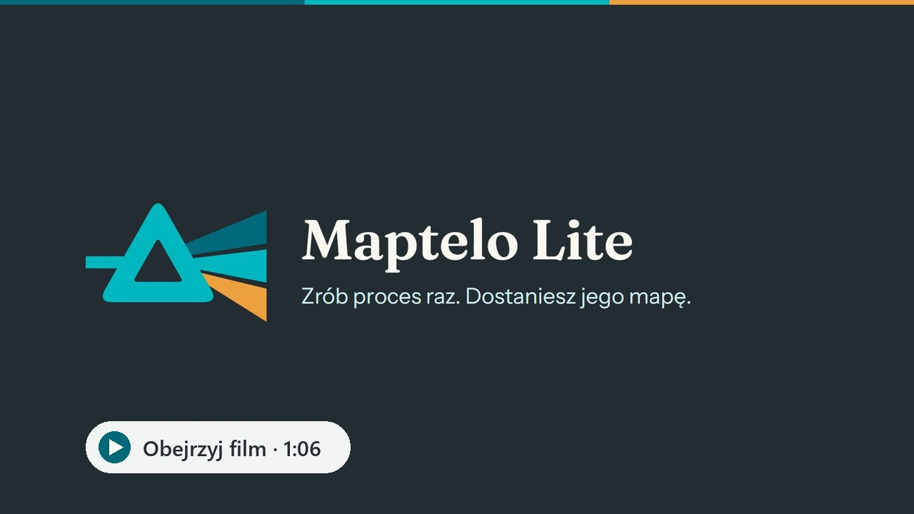
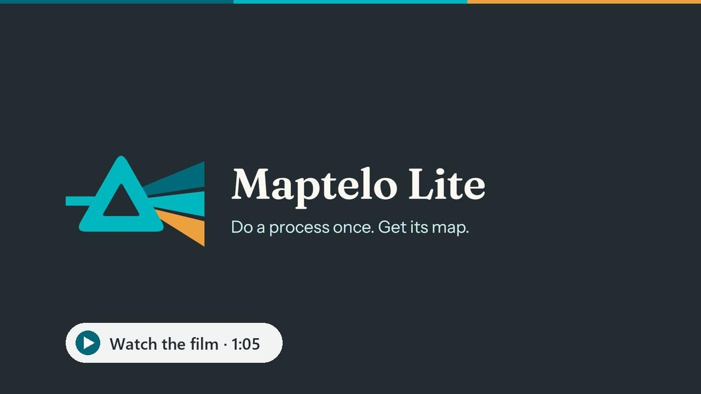

# Maptelo Lite

[](https://github.com/krapcys1-maker/maptelo-lite/actions/workflows/ci.yml)
[](https://github.com/krapcys1-maker/maptelo-lite/releases/latest)
[](LICENSE)

**Zrób proces raz, tak jak zwykle — dostaniesz jego mapę:** kroki po ludzku, instrukcję krok po
kroku (SOP) ze zrzutami ekranu, diagram, BPMN i raport. Bez robota, bez AI, nic nie wychodzi
z Twojego komputera.

**[Pobierz dla Windows](https://maptelo.dev/pobierz/)** · [Jak działa](https://maptelo.dev/lite/) ·
[English below](#english)

[](https://maptelo.dev/lite/)


## Co robi

- **Nagrywa proces** zrobiony w przeglądarce (Edge, Chrome albo Chromium) albo w programie Java
  na Windows (przez Java Access Bridge, także gdy program ma własną Javę).
- **Od razu robi mapę** jednego nagrania, w folderze `maps/<proces>/<nagranie>/`:
  - `sop.md` — instrukcja krok po kroku: dane wejściowe, kroki („Wybierz z menu „Ceny” pozycję
    „Cennik klienta””, „Wpisz Indeks”, „W oknie „Nowa wersja ceny” kliknij „Zapisz””), oczekiwane
    wyniki, zrzut ekranu każdego kroku z zaznaczonym elementem;
  - `process.svg` i `process.mmd` — diagram (SVG i Mermaid);
  - `process.bpmn` — BPMN 2.0 do narzędzi do modelowania procesów;
  - `report.html` — raport w jednym pliku, gotowy do wysłania;
  - `model.yaml` — opis procesu w formacie Maptelo (schemat: `schemas/`).
- **Okno Maptelo Lite** prowadzi przez wszystko: nowy proces, nagranie, mapa, „Gotowość”
  (co ten komputer pozwala nagrać i czego brakuje). Po polsku albo po angielsku: przełącznik
  jest na dole panelu po lewej (na początek język komputera), a instrukcja i raport powstają
  w wybranym języku.

| Nowy proces: nazwa, adres i nagrywanie | Instrukcja: krok ze zrzutem i zaznaczonym miejscem |
| --- | --- |
|  |  |

## Czego nie robi

Nie uruchamia procesów i nie używa AI. Robot, który wykonuje zmapowany proces i potwierdza wynik
niezależnym odczytem, to pełne Maptelo: [maptelo.dev](https://maptelo.dev).

## Programy Java

Lite czyta okna programu Java tak jak czytniki ekranu: przez Java Access Bridge. Most musi być
włączony (`jabswitch -enable` z folderu `bin` Javy albo przez dział IT); Lite znajduje go także
w Javie dołączonej do programu, a „Gotowość” pokazuje, czy działa. Sprawdzone na programach
Swing, również na czystym Windows z programem, który ma tylko własną Javę. Oracle Forms też
korzysta z Java Access Bridge, ale na nim Lite nie był jeszcze sprawdzany.

## Prywatność

- Wszystko zostaje na tym komputerze, w folderze Maptelo Lite. Lite sam nie łączy się z żadnym
  serwerem: otwiera tylko aplikację, w której nagrywasz proces. Okno działa pod adresem
  127.0.0.1 z kluczem, który powstaje przy każdym uruchomieniu.
- Hasła nigdy nie są zapisywane.
- Tryb prywatny zakrywa na zrzutach wpisane wartości i zawartość tabel, a mapa nie przechowuje
  wartości jako przykładów.

## Instalacja


- **Instalator** (Windows 10/11, 64-bit, bez uprawnień administratora):
  [Maptelo-Lite-Setup.exe](https://github.com/krapcys1-maker/maptelo-lite/releases/latest/download/Maptelo-Lite-Setup.exe)
  albo [maptelo.dev/pobierz](https://maptelo.dev/pobierz/) (z sumami SHA-256). Pyta, gdzie
  zainstalować (domyślnie `Pulpit\Maptelo Lite`), i nie zapisuje niczego w folderach ani
  rejestrze Windows: w folderze programu są też Twoje procesy (`Procesy`) i zapamiętane
  logowania (`data`). Skróty w menu Start i na pulpicie są do wyboru. Odinstalowanie:
  „Odinstaluj Maptelo Lite” w folderze programu (procesy zostają) albo po prostu usunięcie
  folderu.
- **To prototyp bez podpisu kodu**, więc Edge może zapytać, czy zachować plik, a Windows
  SmartScreen ostrzec przy uruchomieniu: „Więcej informacji”, potem „Uruchom mimo to”.
- **Wersja przenośna**
  ([Maptelo-Lite-portable.zip](https://github.com/krapcys1-maker/maptelo-lite/releases/latest/download/Maptelo-Lite-portable.zip)):
  rozpakuj w dowolne miejsce i uruchom `Maptelo Lite.cmd`; wszystko zostaje w jej folderze.
- **Z kodu** (Python 3.12):

  ```bash
  pip install ".[studio]"
  maptelo-lite
  ```

  Nagrywanie w przeglądarce używa Edge albo Chrome z komputera; Chromium dla Playwright można
  doinstalować: `python -m playwright install chromium`.

## Wiersz poleceń

```bash
maptelo-lite                                   # okno Maptelo Lite
maptelo-lite record https://erp.example.com --process zmiana-ceny
maptelo-lite record --java "System Rozliczeń" --process ceny-srk
maptelo-lite map recordings/zmiana-ceny/<nagranie>
```

## Rozwój

```bash
uv sync
uv run playwright install chromium   # testy end-to-end nagrywają w MiniERP, aplikacji testowej
uv run pytest
```

Maptelo Lite to otwarta część Maptelo: ten kod powstaje w repozytorium pełnego Maptelo i jest
stamtąd eksportowany. Zgłoszenia i propozycje zmian są mile widziane — trafiają do obu.

## Licencja

Apache License 2.0 — zob. [LICENSE](LICENSE) i [NOTICE](NOTICE). Fonty w
`src/maptelo/studio/static/fonts/` są na licencji SIL Open Font License 1.1 (pliki `OFL-*.txt`).

---

## English

**Do a process once, the way you always do — get its map:** the steps in plain words, a
step-by-step instruction (SOP) with screenshots, a diagram, BPMN and a report. No robot, no AI,
nothing leaves your computer.

**[Download for Windows](https://maptelo.dev/en/download/)** ·
[How it works](https://maptelo.dev/en/lite/)

[](https://maptelo.dev/en/lite/)


- **Records** a process done in a browser (Edge, Chrome or Chromium) or in a Java desktop program
  on Windows (through the Java Access Bridge, also when the program brings its own Java).
- **Maps one recording** into `maps/<process>/<recording>/`: `sop.md` (inputs, steps, expected
  results, a screenshot of each step with the element marked), `process.svg` and `process.mmd`
  (diagram), `process.bpmn` (BPMN 2.0), `report.html` (one file, ready to send) and `model.yaml`.
- **The Maptelo Lite window** guides you: a new process, the recording, its map, and
  "Readiness" (what this computer can record and what is missing). In English or Polish: the
  switch is at the foot of the left panel (at first, the computer's own language).

| A new process: its name, its address, record | The instruction: a step with its screenshot, the place marked |
| --- | --- |
|  |  |

- **Java programs** are read the way screen readers read them, through the Java Access Bridge
  (enable it with `jabswitch -enable`, or ask IT). Tested with Swing programs, also on a clean
  Windows with a program that has only its own Java; Oracle Forms uses the bridge too, but Lite
  has not been tested on it yet.
- **Does not run processes and uses no AI.** The robot that runs a mapped process and confirms
  the result by an independent read is the full Maptelo: [maptelo.dev](https://maptelo.dev).
- **Private by design:** everything stays on this computer, in Maptelo Lite's folder; Lite itself
  connects to no server, it only opens the application you record in. The window listens on
  127.0.0.1 with a key made at each start, passwords are never stored, and private mode covers
  typed values and tables on screenshots.


**Install** with
[Maptelo-Lite-Setup.exe](https://github.com/krapcys1-maker/maptelo-lite/releases/latest/download/Maptelo-Lite-Setup.exe)
(Windows 10/11, 64-bit; checksums on [maptelo.dev/en/download](https://maptelo.dev/en/download/)):
it asks where (the Desktop first), needs no administrator rights and writes nothing to Windows'
folders or registry; your processes (`Processes`) and remembered sign-ins (`data`) stay in that
folder, the Start menu and Desktop shortcuts are your choice, and deleting the folder removes
everything. A prototype, not code-signed yet: Edge may ask whether to keep the file and Windows
SmartScreen may warn when it starts ("More info", then "Run anyway"). A
[portable zip](https://github.com/krapcys1-maker/maptelo-lite/releases/latest/download/Maptelo-Lite-portable.zip)
is there too; or from source with Python 3.12: `pip install ".[studio]"`, then `maptelo-lite`.

For development: `uv sync`, `uv run playwright install chromium`, `uv run pytest`. Maptelo Lite is
the open part of Maptelo, exported from the full Maptelo's repository; issues and pull requests
are welcome.

Licensed under the Apache License 2.0 ([LICENSE](LICENSE), [NOTICE](NOTICE)); the bundled fonts
are under the SIL Open Font License 1.1.
