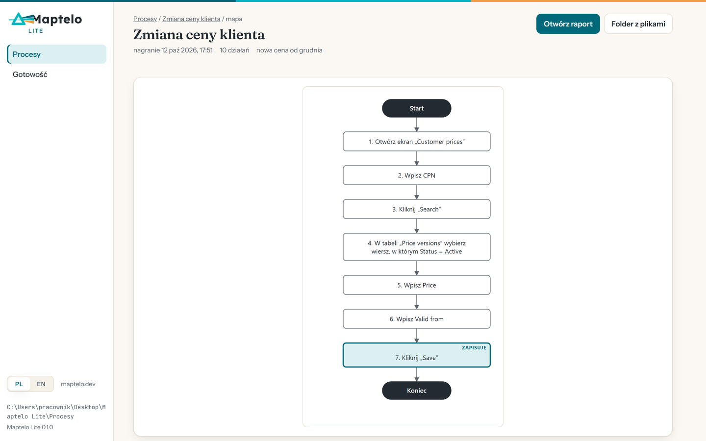
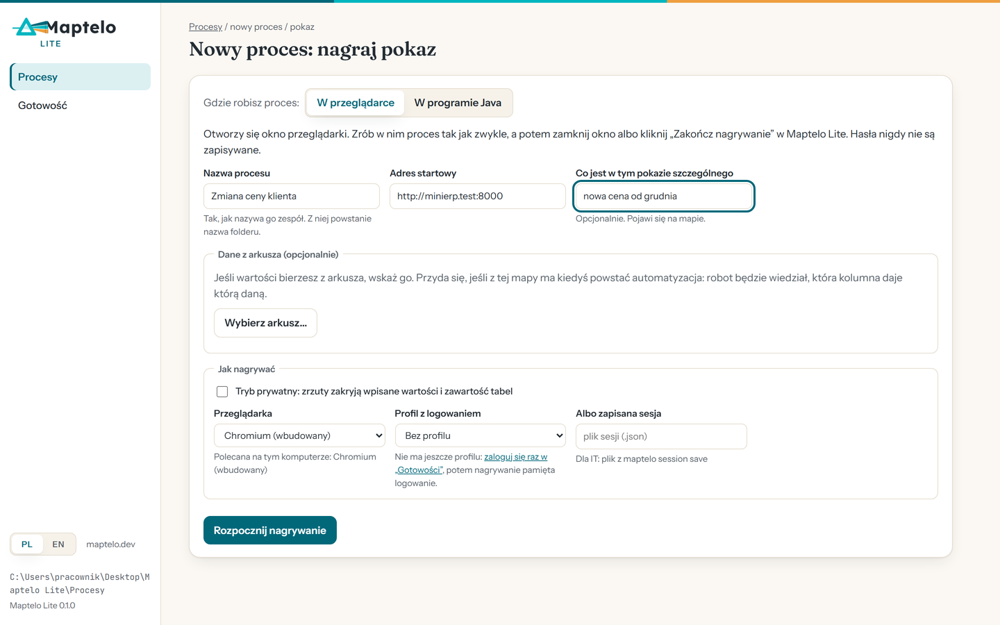
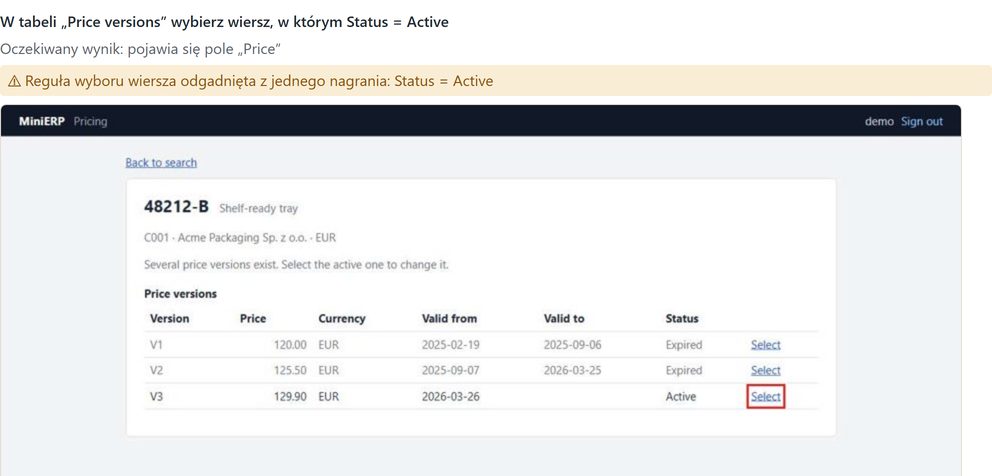
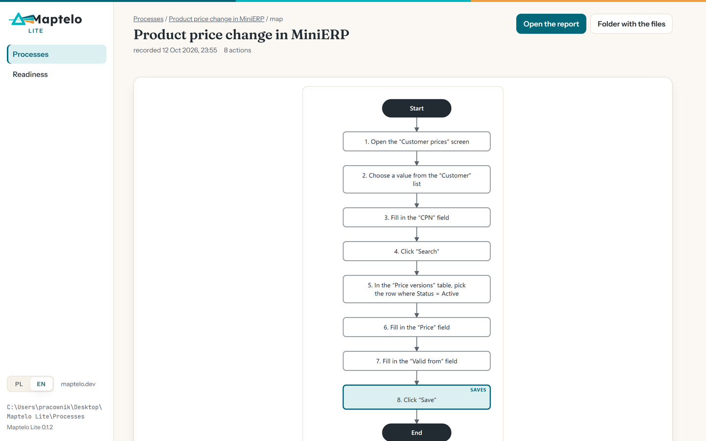
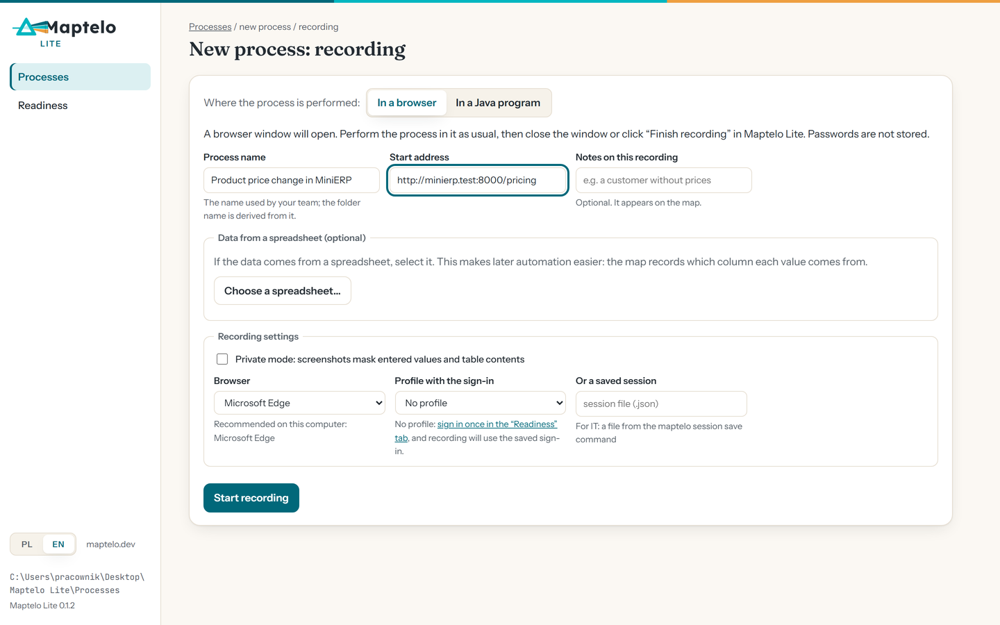
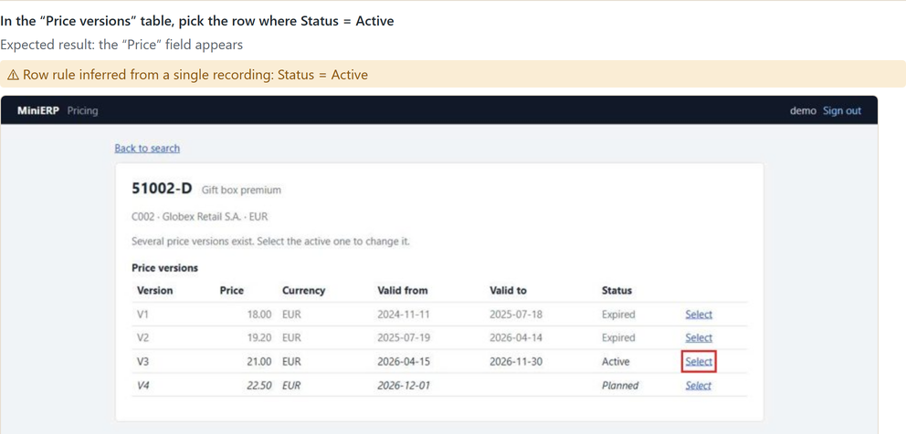
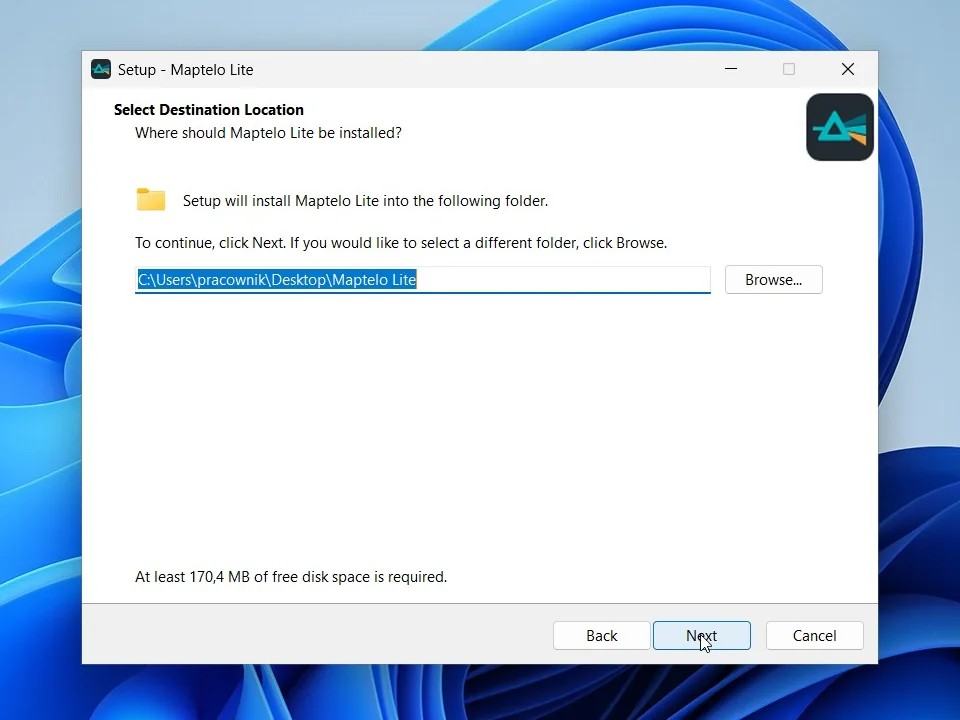

# Maptelo Lite

[](https://github.com/krapcys1-maker/maptelo-lite/actions/workflows/ci.yml)
[](https://github.com/krapcys1-maker/maptelo-lite/releases/latest)
[](LICENSE)

**Dokumentacja procesu z jednego nagrania.** Maptelo Lite rejestruje proces wykonywany
w przeglądarce lub w programie Java i przygotowuje instrukcję stanowiskową (SOP) ze zrzutami
ekranu, diagram procesu, model BPMN oraz raport. Program działa lokalnie i nie korzysta ze sztucznej
inteligencji.

**[Pobierz dla Windows](https://maptelo.dev/pobierz/)** · [Opis programu](https://maptelo.dev/lite/) ·
[English](#english)



## Funkcje

- **Nagrywanie procesu** w przeglądarce (Microsoft Edge, Google Chrome lub Chromium) albo
  w programie okienkowym Java na Windows (przez Java Access Bridge, także gdy program ma własne
  środowisko Java).
- **Mapa procesu z jednego nagrania**, zapisywana w folderze `maps/<proces>/<nagranie>/`:
  - `sop.md` — instrukcja stanowiskowa: dane wejściowe, kolejne kroki (np. „Wybierz z menu „Ceny”
    pozycję „Cennik klienta””, „W oknie „Nowa wersja ceny” kliknij „Zapisz””), oczekiwane wyniki
    oraz zrzut ekranu każdego kroku z oznaczonym elementem;
  - `process.svg` i `process.mmd` — diagram procesu (SVG i Mermaid);
  - `process.bpmn` — model BPMN 2.0 do narzędzi do modelowania procesów;
  - `report.html` — pełna dokumentacja w jednym pliku;
  - `model.yaml` — opis procesu w formacie Maptelo (schemat: `schemas/`).
- **Interfejs w języku polskim i angielskim.** Język zmienia przełącznik w lewym dolnym rogu okna,
  domyślnie używany jest język systemu. Instrukcja i raport powstają w wybranym języku.
- **Zakładka „Gotowość”** pokazuje, co można nagrać na danym komputerze i czego brakuje.

| Nowy proces: nazwa, adres aplikacji, nagrywanie | Krok instrukcji: zrzut ekranu z oznaczonym elementem |
| --- | --- |
|  |  |

## Zakres

Maptelo Lite dokumentuje procesy; nie wykonuje ich i nie korzysta ze sztucznej inteligencji.
Automatyczne wykonanie procesu z potwierdzeniem wyniku niezależnym odczytem z systemu zapewnia
pełne Maptelo: [maptelo.dev](https://maptelo.dev).

## Programy Java

Maptelo Lite odczytuje okna programów Java przez Java Access Bridge, mechanizm, z którego
korzystają również czytniki ekranu. Mechanizm musi być włączony (polecenie `jabswitch -enable`
z folderu `bin` środowiska Java lub konfiguracja przez dział IT). Program wykrywa go także
w środowisku Java dołączonym do aplikacji, a zakładka „Gotowość” pokazuje jego stan. Działanie
sprawdzono na programach Swing, w tym na czystym systemie Windows z programem dysponującym
wyłącznie własnym środowiskiem Java. Oracle Forms korzysta z tego samego mechanizmu, ale nie był
jeszcze testowany z Maptelo Lite.

Komputer, na którym jest tylko 32-bitowa Java (na przykład Java 7 lub 8 w wersji 32-bitowej), ma
wyłącznie 32-bitową bibliotekę mostu (`WindowsAccessBridge-32.dll`). Maptelo Lite odczytuje
wtedy program przez dołączony 32-bitowy Python (folder `python32`), bez uprawnień administratora
i bez zmian w instalacji Javy. Działanie sprawdzono na 32-bitowej Javie 8 (Temurin 8u472).

## Prywatność

- Dane pozostają na komputerze, w folderze Maptelo Lite. Program nie łączy się z żadnym serwerem
  i otwiera wyłącznie nagrywaną aplikację. Okno działa pod adresem 127.0.0.1 i przyjmuje tylko
  żądania z kluczem tworzonym przy każdym uruchomieniu.
- Hasła nie są zapisywane.
- Tryb prywatny zasłania na zrzutach ekranu wprowadzone wartości i zawartość tabel; mapa nie
  przechowuje ich jako przykładów.

## Instalacja


- **Instalator** (Windows 10 i 11, 64-bit, bez uprawnień administratora):
  [Maptelo-Lite-Setup.exe](https://github.com/krapcys1-maker/maptelo-lite/releases/latest/download/Maptelo-Lite-Setup.exe)
  lub [maptelo.dev/pobierz](https://maptelo.dev/pobierz/) (z sumami kontrolnymi SHA-256).
  Instalator pozwala wybrać folder docelowy (domyślnie `Pulpit\Maptelo Lite`) i nie zapisuje
  danych w folderach systemowych ani w rejestrze Windows. W folderze programu znajdują się również
  procesy (`Procesy`) i zapamiętane sesje logowania (`data`). Skróty w menu Start i na pulpicie są
  opcjonalne. Odinstalowanie: „Odinstaluj Maptelo Lite” w folderze programu (procesy pozostają)
  lub usunięcie całego folderu.
- **Brak podpisu kodu.** Wersje 0.x nie są jeszcze podpisane, dlatego Edge może poprosić
  o potwierdzenie pobrania, a Windows SmartScreen o potwierdzenie uruchomienia („Więcej
  informacji”, a następnie „Uruchom mimo to”).
- **Wersja przenośna**
  ([Maptelo-Lite-portable.zip](https://github.com/krapcys1-maker/maptelo-lite/releases/latest/download/Maptelo-Lite-portable.zip)):
  należy rozpakować archiwum w wybranym miejscu i uruchomić `Maptelo Lite.cmd`; wszystkie dane
  pozostają w jego folderze.
- **Ze źródeł** (Python 3.12):

  ```bash
  pip install ".[studio]"
  maptelo-lite
  ```

  Nagrywanie w przeglądarce korzysta z zainstalowanej przeglądarki Edge lub Chrome; Chromium dla
  Playwright można zainstalować poleceniem `python -m playwright install chromium`.

## Wiersz poleceń

```bash
maptelo-lite                                   # okno Maptelo Lite
maptelo-lite record https://erp.example.com --process zmiana-ceny
maptelo-lite record --java "System Rozliczeń" --process ceny-srk
maptelo-lite map recordings/zmiana-ceny/<nagranie>
```

## Rozwój

```bash
uv sync
uv run playwright install chromium   # testy end-to-end nagrywają w MiniERP, aplikacji testowej
uv run pytest
```

Maptelo Lite jest otwartą częścią Maptelo: kod powstaje w repozytorium pełnego Maptelo i jest
z niego eksportowany. Zgłoszenia błędów i propozycje zmian są mile widziane.

## Licencja

Apache License 2.0 — zob. [LICENSE](LICENSE) i [NOTICE](NOTICE). Fonty w
`src/maptelo/studio/static/fonts/` są na licencji SIL Open Font License 1.1 (pliki `OFL-*.txt`).

---

## English

**Process documentation from a single recording.** Maptelo Lite records a process performed in
a browser or a Java program and produces a work instruction (SOP) with screenshots, a process
diagram, a BPMN model and a report. It runs locally and uses no AI.

**[Download for Windows](https://maptelo.dev/en/download/)** ·
[Product page](https://maptelo.dev/en/lite/)



- **Recording** in a browser (Microsoft Edge, Google Chrome or Chromium) or in a Java desktop
  program on Windows (through the Java Access Bridge, including programs that ship their own Java
  runtime).
- **A process map from a single recording**, saved in `maps/<process>/<recording>/`: `sop.md`
  (inputs, steps, expected results and a screenshot of every step with the element marked),
  `process.svg` and `process.mmd` (process diagram), `process.bpmn` (BPMN 2.0 model),
  `report.html` (the complete documentation in one file) and `model.yaml`.
- **English and Polish interface**, switched in the lower-left corner of the window (the system
  language by default); the instruction and the report follow the chosen language. The
  **Readiness** tab shows what can be recorded on the computer and what is missing.

| A new process: name, application address, recording | An instruction step: a screenshot with the element marked |
| --- | --- |
|  |  |

- **Java programs** are read through the Java Access Bridge, the mechanism screen readers use
  (enabled with `jabswitch -enable` or by IT). Tested with Swing programs, including on a clean
  Windows with a program that ships only its own Java runtime. Oracle Forms uses the same
  mechanism but has not yet been tested with Maptelo Lite. On a computer with only a 32-bit
  Java (such as a 32-bit Java 7 or 8), whose bridge library is `WindowsAccessBridge-32.dll`,
  Maptelo Lite reads the program through its bundled 32-bit Python (the `python32` folder), with
  no administrator rights and no change to the Java installation. Tested on a 32-bit Java 8
  (Temurin 8u472).
- **Scope:** Maptelo Lite documents processes; it does not execute them and uses no AI. Automatic
  execution with every result confirmed by an independent read from the system is the full
  Maptelo: [maptelo.dev](https://maptelo.dev).
- **Privacy:** data stays on the computer, in the Maptelo Lite folder. The program connects to no
  server and opens only the application being recorded. The window runs at 127.0.0.1 and accepts
  only requests carrying a key generated at each start. Passwords are not stored; private mode
  masks entered values and table contents on screenshots.



**Installation:**
[Maptelo-Lite-Setup.exe](https://github.com/krapcys1-maker/maptelo-lite/releases/latest/download/Maptelo-Lite-Setup.exe)
(Windows 10 and 11, 64-bit; SHA-256 checksums on
[maptelo.dev/en/download](https://maptelo.dev/en/download/)). The installer lets you choose the
destination folder (`Desktop\Maptelo Lite` by default), requires no administrator rights and
writes nothing to system folders or the Windows registry. Processes (`Processes`) and saved
sign-in sessions (`data`) are kept in the same folder, Start menu and Desktop shortcuts are
optional, and deleting the folder removes everything. Versions 0.x are not yet code-signed, so
Edge may ask you to confirm the download and Windows SmartScreen may ask you to confirm running it
("More info", then "Run anyway"). A
[portable zip](https://github.com/krapcys1-maker/maptelo-lite/releases/latest/download/Maptelo-Lite-portable.zip)
is also available; to run from source with Python 3.12: `pip install ".[studio]"`, then
`maptelo-lite`.

Development: `uv sync`, `uv run playwright install chromium`, `uv run pytest`. Maptelo Lite is the
open part of Maptelo, exported from the full Maptelo repository; bug reports and pull requests are
welcome.

Licensed under the Apache License 2.0 ([LICENSE](LICENSE), [NOTICE](NOTICE)); the bundled fonts
are under the SIL Open Font License 1.1.
